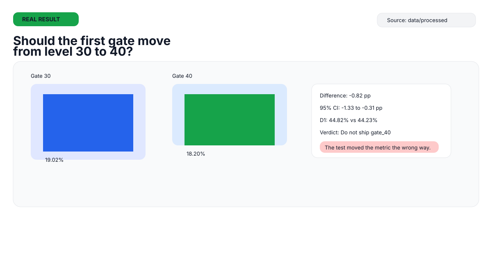
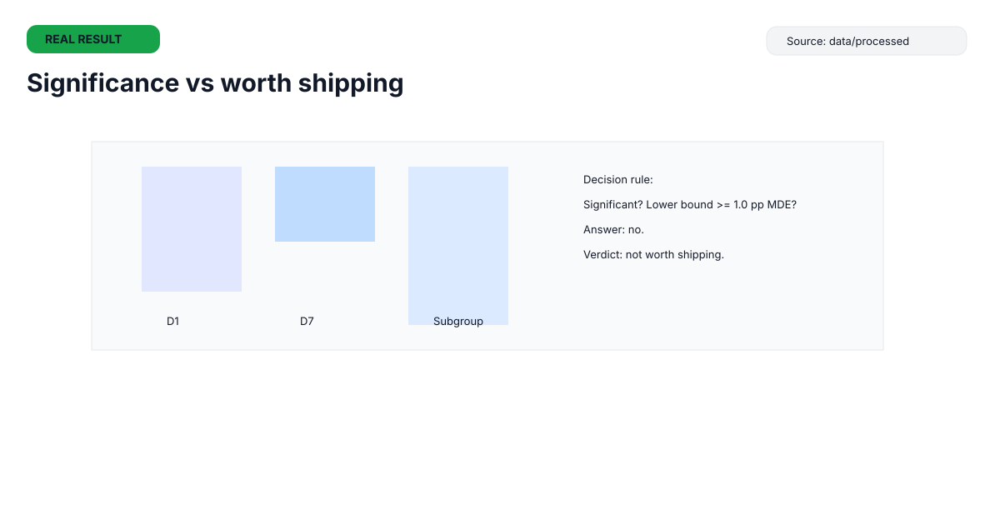
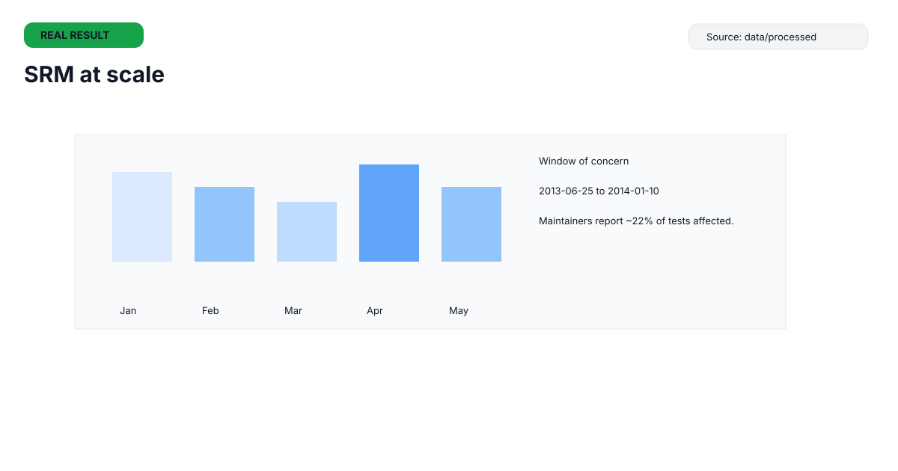

# A/B Testing Playbook

  

  <strong>Data: Real public experiments · SQL · Python · Stats</strong>

This repo is not affiliated with Tactile Entertainment, Upworthy, Cornell, or the dataset hosts. It is an independent analysis written as if I were the PM.

## 30-second summary

- Cookie Cats: 90,189 players, 44,700 in gate_30 and 45,489 in gate_40, with D7 retention of 19.02% vs 18.20% and a difference of -0.82 pp.
- The gate_40 result is statistically significant but below the pre-set decision threshold, so the recommendation is to do not ship gate_40.
- Upworthy shows why real experimentation programs need SRM audits, multiplicity controls, and preregistration.

## How to read this in 60 seconds

- Start with the decision card: [card-01-decision.svg](assets/cards/card-01-decision.svg)
- Review the significance view: [card-04-significance.svg](assets/cards/card-04-significance.svg)
- Check the B2B reality check: [card-10-b2b-reality.svg](assets/cards/card-10-b2b-reality.svg)

## The Case in Plain English

This section is also mirrored in [02-cookie-cats/experiment-brief.md](02-cookie-cats/experiment-brief.md).

This repo takes an experiment from a game product and translates it to product analytics practice for B2B SaaS. The same design logic applies to feature tests, rollout decisions, and user segmentation; the traffic volumes and revenue assumptions do not.

### What is a gate?

A gate is a forced pause where the player must wait or pay to continue. The first gate is the first such pause in a game. The test here asks whether moving that gate later changes retention.

### The experiment

The treatment moved the first gate from level 30 to level 40. Players were randomly assigned at install. The Cookie Cats analysis file contains 90,189 players, split into 44,700 on gate_30 and 45,489 on gate_40.

### Problem statement

Should the first gate move from level 30 to level 40?

### Hypothesis

A later gate gives players more free play before the first important pause, so they are more likely to come back. The trade-off is that the later gate may add friction or remove the immediate reward loop.

### Metrics hierarchy

- Primary: 7-day retention
- Secondary: 1-day retention
- Guardrail: 14-day game rounds (`sum_gamerounds`)

### What the data says

- D7 retention is 19.02% in gate_30 and 18.20% in gate_40, a -0.82 pp difference.
- D1 retention is 44.82% vs 44.23%, which is not significant at 0.05.
- The proportion of players reaching the first gate is 18.5% in gate_30 and 15.3% in gate_40, which suggests exposure was lower in the treatment arm.

### Recommendation

The recommendation is to not ship gate_40 for retention evidence. The effect is not an improvement on the primary metric and does not clear the decision MDE.

### What this data cannot tell us

This dataset has no purchase data, no revenue, and no timestamps, so it cannot estimate novelty effects, day-of-week effects, or the long-term value of the gate change.

## Concept Gallery

Three SVGs highlight the main decision, statistical interpretation, and experiment-quality check; the table lists results for the remaining concepts.

### Featured results

  

  

### Results for the other concepts

| Concept | Result |
|---|---|
| Experiment lifecycle | The analysis proceeds from defining the metric and decision rule to checking data quality and interpreting the result. |
| Metric hierarchy | D7 retention is primary, D1 retention is secondary, and 14-day game rounds are the guardrail. |
| Power and MDE | The preregistered design targets 80% power for a 1.0 pp D7-retention MDE. |
| Exposure | 18.5% of gate_30 players and 15.3% of gate_40 players reached the first gate. |
| Multiple testing | Holm adjustment is applied across the Cookie Cats tests; D7 remains significant while D1 does not. |
| Preregistration | The hypothesis, metrics, alpha, power, and decision threshold are set before analysis. |
| B2B sample-size reality | Detecting small effects requires substantial traffic; the Cookie Cats sample size does not imply the same feasibility for a B2B product. |
| Data limits | No timestamps or purchase data are available, so timing effects and revenue impact cannot be assessed. |
| Upworthy program audit | The archive illustrates why allocation checks and multiplicity controls matter; it does not establish the original team’s decisions. |

Full concept coverage table: [docs/concept-coverage.md](docs/concept-coverage.md)

## Hiring-manager map

- Product analytics and success metrics: [02-cookie-cats/experiment-brief.md](02-cookie-cats/experiment-brief.md)
- SQL work: [sql](sql)
- Hypothesis validation and preregistration: [01-research/prereg.md](01-research/prereg.md)
- Decision memo: [02-cookie-cats/decision-memo.md](02-cookie-cats/decision-memo.md)
- PRD-lite experiment spec: [04-playbook/experiment-spec-template.md](04-playbook/experiment-spec-template.md)
- Roadmap: [04-playbook/followup-experiments.md](04-playbook/followup-experiments.md)
- B2B transfer: [04-playbook/sample-size-table.md](04-playbook/sample-size-table.md)

## How to reproduce

1. Download the raw CSVs into `data/raw` and `data/raw/upworthy/`.
2. Activate the Python environment.
3. `pip install -r requirements.txt`
4. `python scripts/cc_analysis.py`
5. `python scripts/up_audit.py && python scripts/up_program.py && python scripts/up_confirmatory.py --confirm`
6. `pytest -q`

## Method and limits

- Real public data only; no synthetic data was used.
- The repo uses the real Cookie Cats dataset and the public Upworthy archive in the workspace.
- The core Cookie Cats decision rule follows the preregistration and decision MDE in [01-research/prereg.md](01-research/prereg.md).
- The Upworthy archive is used as a program-level audit, not a claim about the original product team.
- This project does not have B2B revenue data, user interviews, or product instrumentation beyond the public files.

## About me

- Name: [Your name]
- Role: [Associate Product Manager / Product Analyst]
- LinkedIn: [LinkedIn URL]
- CV: [CV link]
- Email: [email@example.com]

## Sources

- Matias, Munger, Le Quere, Ebersole (2021), Scientific Data 8:195, https://doi.org/10.1038/s41597-021-00934-7
- Data: https://osf.io/jd64p/
- Cookie Cats dataset: Kaggle, "Mobile Games A/B Testing - Cookie Cats"
